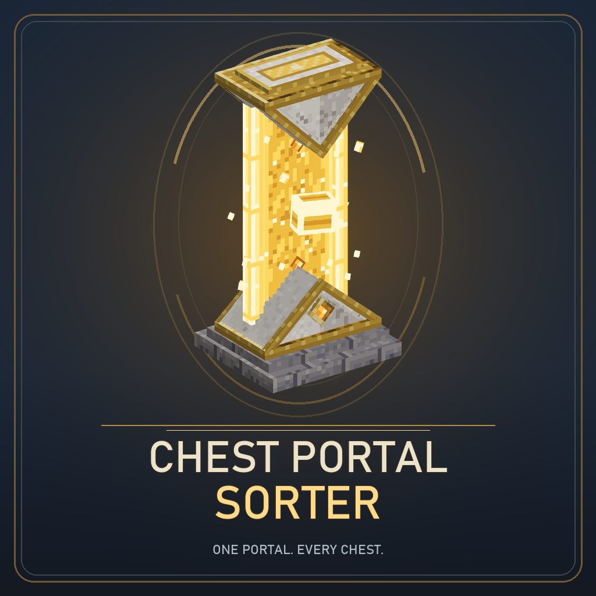
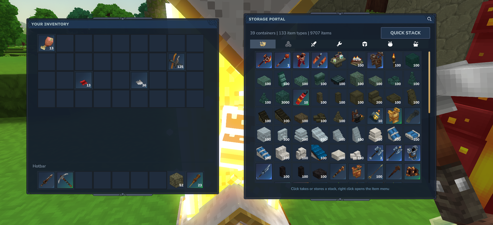

# Chest Portal Sorter

  

**Your storage room, in one window.** The Storage Portal gathers items from nearby containers into a searchable inventory, so you can find, take, and store supplies without visiting each chest.

  

## What it does

- Combines the contents of containers within **20 blocks**, up to **64 containers**. The nearest containers are included first.
- Search by item name or ID, or filter by category.
- Click an item to take or store a stack. Right-click to choose one item, half a stack, or a full stack.
- Use **Quick stack** to deposit items from your inventory that nearby containers already hold.
- Use **Highlight** from an item's menu to mark nearby containers holding it for 10 seconds.

The portal does not store items itself. It reads and transfers items directly from nearby containers.

## Crafting recipe

Craft the Storage Portal at an **Arcane bench** in the **Arcane Misc** category. Crafting takes 5 seconds.

| Ingredient | Quantity |
| --- | ---: |
| Small Crude Chest | 20 |
| Life Essence | 50 |
| Gold Bar | 10 |
| Rock resource | 10 |

>  ### Note
> 
> The portal can access every container within range. It does not check claims or protection plugins, so avoid placing it where other players could use it to access your storage.